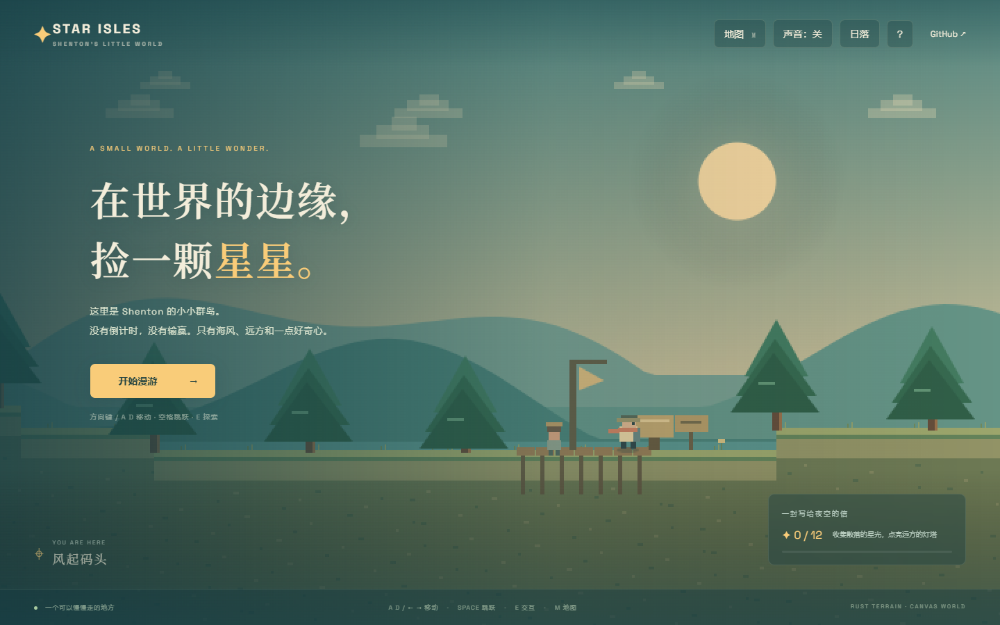

# ✦ Star Isles · 星屿漫游

**A small world. A little wonder.** 一个可以散步、跳跃、收集星光的像素海岸，也是 Shenton 的互动项目主页。

[在线试玩](https://shentonyan.github.io/star-isles/) · [GitHub](https://github.com/shentonyan/star-isles)



沿着海岸，从风起码头经过好奇心书屋、造物工坊和听风花园，带着十二颗星光走到远方的灯塔。这个世界没有战斗、倒计时和失败惩罚。

## 怎么玩

| 操作 | 键位 |
| --- | --- |
| 移动 | ← → / A D |
| 跳跃、登上坡地 | 空格 / W / ↑ |
| 阅读、交谈、点亮灯塔 | E |
| 地图、传送到已发现地点 | M |

手机使用屏幕下方的按钮。碰到星光会自动收集。收集十二颗后，在灯塔按 E。星光和发现的地点会自动保存在当前浏览器；清除网站数据会清除存档。声音默认关闭，可以开启短音效；右上角切换日落与夜晚。

## 本地运行

需要 Node.js 22 或更新版本，不需要安装 npm 依赖：

```sh
npm run dev
```

打开终端显示的本地地址，默认是 http://127.0.0.1:4173 。仓库附带已编译的 Rust WebAssembly 地形核心，可直接试玩。

## Rust 在哪里？

`engine/src/lib.rs` 是零第三方依赖的 Rust 地形核心，编译为 WebAssembly，浏览器直接调用 `terrain_height`。JavaScript 负责 Canvas 绘制、输入、碰撞、镜头、任务与存档。这里没有 Java；浏览器交互使用的是 JavaScript。

如果 WebAssembly 加载失败，使用同公式的 JavaScript 地形回退，并在页脚显示兼容模式。无后端、无账号、无分析追踪。Google Fonts 仅用于字体美化，离线时使用系统字体。

重新编译 Rust：

```sh
rustup target add wasm32-unknown-unknown
npm run build:world
```

检查：

```sh
npm test
cargo test --manifest-path engine/Cargo.toml
```

Node 测试检查地图边界、坡度、收集物布局、损坏存档和通关存档。Rust 测试检查坡度与边界。端到端人工/浏览器检查应覆盖完整步行路线、十二星收集、五地点发现、灯塔交互、刷新存档及手机触控。

## 改成你的世界

- `src/world.js`：地点介绍、项目链接、星光位置。
- `src/game.js`：像素画面、玩法、角色与建筑。
- `style.css`：页面配色、文字、手机布局。
- `engine/src/lib.rs`：地形公式；修改后同步 JavaScript 回退公式。

## 发布到 GitHub Pages

在仓库 **Settings → Pages → Source** 中选择 **GitHub Actions**。推送 main 分支后，工作流测试代码、编译 Rust、打包静态文件并部署。子路径部署受支持，无需服务器或密钥。

## 灵感与许可

灵感来自 [Mars-tin 的可探索像素主页](https://mars-tin.github.io/world/)。学习的是“把主页变成一个可走进去的世界”的交互方式。本项目的代码、像素图形、地图布局与文案独立编写，没有复制原站代码、美术或个人介绍。所有场景使用 Canvas 程序绘制。

MIT License · Copyright © 2026 Shenton YAN.
